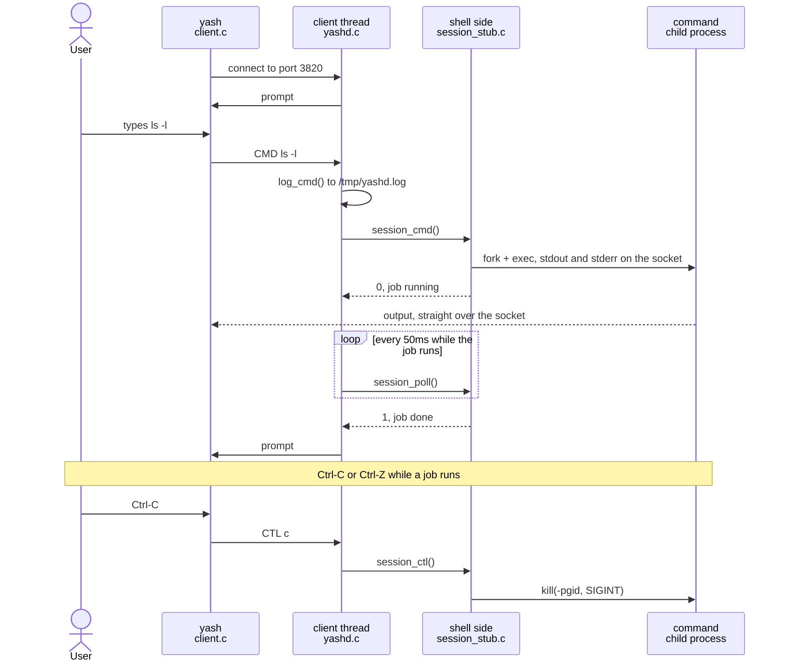
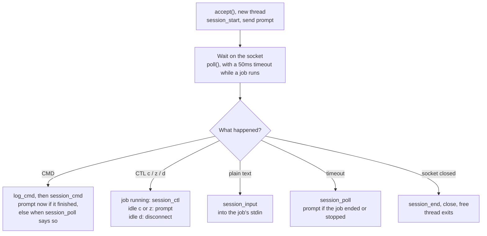

# yashd: Server Side Cheat Sheet

Oct 12, 2026

This is a map of the server side of Project 2: the daemon, the client, logging, and the `session.h` interface the prj1 shell plugs into. `session_stub.c` is a placeholder shell so everything runs end to end today.

## At a glance

One thread per client runs this loop; `yashd.c` owns the socket and the waiting, and the shell side only starts, checks and signals jobs. `session.h` (the `session_t` struct and every prototype) is included by every server file.

## Build and run

`make` builds both programs with `gcc -Wall -Wextra -g -std=gnu99 -pthread`.

| Target or command | What it does |
| --- | --- |
| `make` | Builds `yashd` (server) and `yash` (client) |
| `SHELL_OBJS = session_stub.o` | The shell side; swap in the prj1 objects once they implement `session.h` |
| `./yashd` | Starts the daemon in the background on port 3820 |
| `./yash 127.0.0.1` | Connects a client; type commands at `# ` |
| `cat /tmp/yashd.log` | One line per command |
| `kill $(cat /tmp/yashd.pid)` | Stops the daemon |
| `make clean` | Removes both programs and all `.o` files |

## Function index

| Function | File | What it does | Called by |
| --- | --- | --- | --- |
| `main` | `yashd.c` | Daemonizes, creates the listening socket, accepts clients, starts a detached thread per client | (entry point) |
| `daemon_init` (static) | `yashd.c` | Fork and exit parent, `setsid`, ignore SIGHUP, `chdir("/")`, `umask(0)`, close fds, stdio to `/dev/null`, lock `/tmp/yashd.pid` | `main` |
| `reusePort` (static) | `yashd.c` | `SO_REUSEADDR` so the daemon can rebind 3820 right after a restart | `main` |
| `serve_client` (static) | `yashd.c` | The thread: `poll()` on the socket, waking every 50ms while a foreground job runs to call `session_poll` | `pthread_create` |
| `read_messages` (static) | `yashd.c` | `read()` into the session's `inbuf`; 0 bytes means the client left | `serve_client` |
| `handle_lines` (static) | `yashd.c` | Splits `inbuf` on `\n`; a `CMD` that arrives while a job runs waits in the buffer | `read_messages`, `serve_client` |
| `handle_msg` (static) | `yashd.c` | `CMD` → log + `session_cmd`; `CTL` → `session_ctl` or re-prompt; other text → `session_input` | `handle_lines` |
| `session_send`, `session_printf` | `yashd.c` | Write text to the client, looping on partial writes | shell side, `send_prompt` |
| `send_prompt` (static) | `yashd.c` | Sends `"\n# "` | `serve_client`, `handle_msg` |
| `log_cmd`, `log_error` | `log.c` | Append one line to `/tmp/yashd.log` under a mutex | `handle_msg`, `daemon_init`, `main` |
| `main` | `client.c` | Connects to `<IP>:3820`, `poll()`s stdin and the socket, turns lines into `CMD` or plain text | (entry point) |
| `sig_int`, `sig_tstp` (static) | `client.c` | Send `CTL c` / `CTL z`; the client itself never stops | kernel |
| `session_start` … `session_end` | `session_stub.c` | Placeholder shell: one command at a time, no pipes or jobs | `serve_client`, `handle_msg` |

## Feature traces

| Feature | Call chain | Where the key work happens |
| --- | --- | --- |
| Client connects | `main` → `accept` → `pthread_create(serve_client)` → `session_start` → prompt | One `session_t` per client, freed when the thread ends |
| Command (`ls -l`) | client sends `CMD ls -l` → `read_messages` → `handle_lines` → `handle_msg` → `log_cmd` → `session_cmd` | `session_cmd` starts the job and returns; output goes straight from the child to the socket |
| Command finishes | `serve_client` poll timeout → `session_poll` returns 1 → `send_prompt` | Prompt goes out only after the job is reaped |
| Ctrl-C / Ctrl-Z | client `sig_int` / `sig_tstp` → `CTL c` / `CTL z` → `handle_msg` → `session_ctl` → `kill(-fg_pgid, …)` | At an idle prompt the server just re-prompts |
| Typed input (`cat`) | client sees no prompt yet, sends the line as plain text → `handle_msg` → `session_input` → job's stdin pipe | `CTL d` closes the pipe, so the job sees EOF |
| Commands sent back to back | `handle_lines` stops at a `CMD` while `fg_pgid > 0`, resumes after `session_poll` returns 1 | Keeps piped or scripted input in order |
| Client quits | Ctrl-D or `quit` at the prompt → `CTL d`, or the socket closes → loop ends → `session_end` → `close`, `free` | `session_end` kills that client's jobs |
| Logging | `handle_msg` → `log_cmd` → `log_line` | `Oct 12 21:07:55 yashd[127.0.0.1:7813]: ls -l` |

## Data structures

| Type | Fields | Written by | Read by |
| --- | --- | --- | --- |
| `session_t` (one per client, `calloc` in `main`) | `sock`, `ip`, `port`, `inbuf`, `inlen` | `main`, `read_messages`, `handle_lines` | everything |
| `session_t`, shell part | `fg_pgid` (0 at the prompt), `in_fd` (job's stdin pipe), job table to add | shell side | `serve_client`, `handle_msg` |
| `log_lock` (static in `log.c`) | `pthread_mutex_t` | `log_line` | `log_line` |

## Life of a connection

Every branch except the last goes back to waiting on the socket.

## What the shell side implements

Everything in `session.h` under "implemented by the shell side". `session_stub.c` is a working example of each.

| Function | Must do | Return |
| --- | --- | --- |
| `session_start(s)` | Set up this client's job table | — |
| `session_cmd(s, line)` | Parse and launch; set `s->fg_pgid` for a foreground job and return without waiting | 1 if done (builtin, `&`, bad line), 0 if a foreground job is running |
| `session_poll(s)` | `waitpid(-fg_pgid, WNOHANG \| WUNTRACED)`; on exit or stop update the table and clear `fg_pgid` | 1 when the foreground job ended or stopped |
| `session_ctl(s, c)` | `'c'` → SIGINT, `'z'` → SIGTSTP to `-fg_pgid`; `'d'` → close the job's stdin pipe | — |
| `session_input(s, buf, len)` | Write typed text into the job's stdin pipe | — |
| `session_end(s)` | Kill every job this client still has | — |

## Gotchas for the shell side

- **No blocking in `foreground()`.** The thread must keep reading the socket, or Ctrl-C can't reach the job. That's why `session_cmd` returns and `session_poll` checks back.
- **Pipes need close-on-exec** (`fcntl(fd, F_SETFD, FD_CLOEXEC)`). All clients share one process, so a command forked for one client would otherwise hold another client's pipe open, and its reader would never see EOF.
- **No SIGCHLD handler, no `waitpid(-1)`.** A handler is process-wide and doesn't know which client's table to touch; each thread reaps only its own groups with `waitpid(-pgid, …)`.
- **Reset SIGPIPE to default in the child.** The daemon ignores it, and ignored signals survive `exec`.
- **No terminal.** Drop `tcsetpgrp`; Ctrl-C and Ctrl-Z arrive through `session_ctl`.
- **Output goes to the socket.** In the child, `dup2(s->sock, 1)` and `dup2(s->sock, 2)`; in the shell, `session_printf(s, …)` instead of `printf` for `jobs`, `fg` and `bg`.
- **Working directory is `/`.** Daemon rule; relative redirects like `> out.txt` fail without root. Use full paths while testing, or we change it to `/tmp`.
